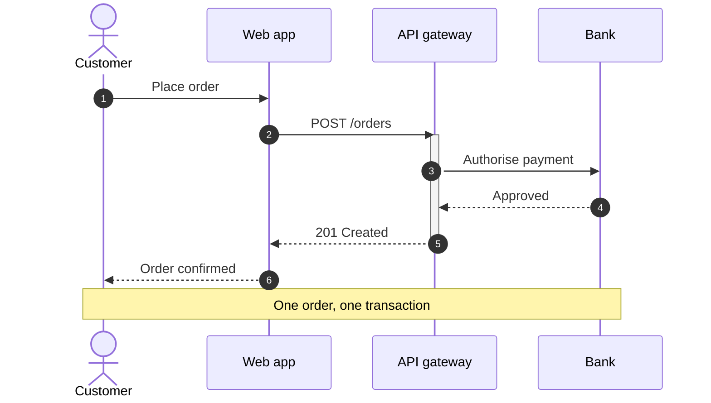

# Marklar
Marklar weaves linked actions and rules directly into Markdown, turning specs into a single, interactive source of truth with live formulas and ready-to-export data. 
Check out the [full markup specification](full-markup-specification).

## Philosophy
The core idea is simple: **the design document should be the single source of truth** for the entire project.

Marklar lets you describe data, conditions, logic, and user flows in a single, readable document — without code or piles of custom syntax. The same document can be used to export data, process it automatically, and integrate it directly into software. No need to move things into spreadsheets, separate data files, or dedicated scenario editors.

Marklar is built on [GitHub Flavored Markdown](https://github.github.com/gfm/). Markdown is easy to read, write, and edit without special tools. It works naturally with Git version control and is well understood by AI assistants and parsers.

Marklar keeps all of that while adding features needed for more complex project documentation. A Marklar file is always a regular `.md` file. Its structure relies on standard Markdown elements: headings, paragraphs, lists, and tables. The extension adds extra meaning to these elements without replacing the original format.

## Principles
* **One document, one source of truth.** All data and scenario logic live in Markdown. Other formats, including JSON, XML, YAML, and scenario scripts, are generated from the document rather than maintained separately.
* **A table is a ready-made class definition.** You don't need anything beyond a regular table to describe structured data. Rows represent instances, the first column defines their IDs, and the remaining columns define their properties. Cell formulas are calculated automatically, and you can reference data by object and property names. A table works both as a familiar Excel-style spreadsheet and as a simple object model.
* **Keep additions to a minimum.** There's no point in introducing new syntax for things Markdown already handles perfectly well. Markdown headings define the scenario hierarchy: each heading is a node, nested headings are child nodes, and bullet points represent choices. The same hierarchy defines the scope of local variables. No separate scenario graph or namespace management needed.
* **Keep the text clean.** First and foremost, this is a text document. Language constructs should never get in the way of reading it outside a dedicated editor. They should feel intuitive, fit naturally into the text, and require little or no learning.
* **Minimal syntax.** Mathematical formulas and object relationships can get complex, but scenario logic should stay simple. The language deliberately has no loops, functions, nested structures, code blocks with braces, or recursion. This isn't a programming language. It's a tool for writing living specifications.

## Built-in Tables as a Data Source
The first cell of a table defines its class name, each row represents an object, and columns define its properties. This is already the de facto standard for configuration tables, game content, and software data. Here's what it looks like:

> [!NOTE] Live formulas!
> All the formulas in the text and tables calculate live - try changing the variables or table values to test it out.

baseArmor = 5
baseHealth = 100

<!-- widths: [178, 82, 84, 73, 0, 0] -->
| NPC      | Speed         | Health modifier | Health                          | Damage | Armor      |
| -------- | ------------: | --------------: | ------------------------------: | -----: | ---------: |
| Zombie   | 10            | 0.2             | =baseHealth*this.HealthModifier | 10     | 0          |
| Warrior  | 20            | 1.0             | =baseHealth*this.HealthModifier | 100    | =baseArmor |
| Skeleton | =zombie.speed | 0.5             | =baseHealth*this.HealthModifier | 30     | 0          |

Tables also support formulas like `skeleton.speed = zombie.speed`, alongside relative cell references such as `B1 = B2-C3` for compatibility with traditional spreadsheets.

Everything defined in a table can be used elsewhere in the document, and vice versa. For example, we can calculate how much damage a Warrior takes from a Zombie in one round, taking armor into account: %=max(1, NPC.Zombie.Damage - NPC.Warrior.Armor)%

But here's the best part: you can export all the data in the entire document to JSON with a single click. Either as one file or as separate files for each table, all using a consistent format. And the source is still just a regular Markdown table.

In the editor, you can create a table simply by typing `| ` at the beginning of a line. As soon as you enter the space, an empty table is created. You can resize it using Ctrl + Arrow keys, Backspace, Delete, and Enter. The result is saved to `.md` as a neatly formatted Markdown table.

## Formulas Work Right Inside the Text
You can declare variables and do math directly in the document using natural, straightforward mathematical expressions. No code and no abstract spreadsheet-style notation needed.

This lets you describe not just project math, but also complex objects with their own properties and variables used in scenario logic.

For example, let's say we have:

health = NPC.Warrior.Health       // equals %health% from the table above
armor = NPC.Warrior.Armor        
damage = 100

Our damage calculation looks like this:
outcomeHealth = round(health - max(1, damage - armor))
// With these inputs, the result is %outcomeHealth% HP.

All calculations happen on the fly in the editor. To insert a calculated value into the text, use the special `%=formula%` or `%variable%` tags.

## Markdown Extensions
> [!NOTE] External extensions can be disabled individually in the settings menu.
> GitHub-style block quotes are supported, making it easy to collaborate on documents and leave comments directly in the text.

Wiki-links and Obsidian-style anchors are supported out of the box, along with ~~strikethrough~~ and ==highlighted== text.

[KaTeX](https://khan.github.io/KaTeX) provides support for LaTeX mathematical expressions.

$$
% \f is defined as #1f(#2) using the macro
f\relax{x} = \int_{-\infty}^\infty
f\hat\xi\,e^{2 \pi i \xi x}
\,d\xi
$$

UML diagrams are also supported through [Mermaid](https://mermaidjs.github.io/).



# Scenario Markup Language
You can run and debug scenarios right in the editor, or switch to a visual mode and edit them using logical blocks. Any changes made in visual mode are reflected in the scenario text in the document.

Scenarios can be exported as JSON data and integrated directly into your product. All dialogue text is extracted into a separate localization table.

Scenario nodes are defined just like regular Markdown sections, using headings. The language has just a few operators: a condition, a transition to another node, and a couple of utility tags for text formatting.

Operators have no nesting, curly braces, or anything like that. The goal is to keep the document readable. Calculations inside scenario logic happen only when the scenario is executed.

> [!NOTE] Live scenario!
> You can run this scenario example right in the editor; just click  in the left menu bar.

## -> Scenario Example
?  (!count) // first time entering the bar
money = 5
You suddenly find yourself in a bar. There's a counter in front of you, with a bartender polishing glasses behind it. A chalkboard on the wall reads: "Happy Hour! Everything's a dollar!"
You happen to have $%money% on you.

?  else
You're still in the bar. You've got $%money% in your pocket.

?  (beer)
But now you're holding a mug of cold beer.
?  (coffee)
And you've got a cup of coffee in your hands. It's already getting cold.

* Greet the bartender :: You said hello. The bartender said hello back.

? (coffee)
+ Have a coffee.
coffee = 0
-> Scenario Example

? (beer)
+ Drink a beer.
beer = 0
-> Scenario Example

? (!beer && !coffee && money)
+ Order a beer. :: The bartender pours you a beer.
money--
beer++
-> Scenario Example

? (!beer && !coffee && money)
+ Order a coffee. :: The bartender pours you a coffee.
money--
coffee++
-> Scenario Example

+ Leave -> Exit

### Exit
:: You leave the bar. That's the end of the story.

# Full Markup Specification
This article is the formal reference for the Marklar markup: syntax, operators, naming and addressing rules, table semantics, and the order of execution. For an overview of the ideas behind the language, see the sections above.

## Scenario Structure
A scenario is a tree of consecutive choices offered to the user, which they walk through to perform a target action. It may be a dialogue tree of a game, or the screens of an application and the links between them. Scenarios are exported to compact JSON together with the document data and can be played back in a third-party application with the integration libraries.

The language does not aim to localize text inside the scenario document. All text is exported into localization tables, where any number of languages can be added.

### Scenario Nodes
The unit of a scenario is a [node](#nodes): the text under a heading of any level, which is also a namespace for local variables. Small dialogues can be organized inside larger parent nodes at any depth. For example, a parent node can be a location, its child nodes dialogues with specific NPCs, and their sub-nodes parts of those dialogues.

The top-level (parent) scenario node is the entry point. If several nodes sit at the same level, each of them is an entry point into a different scenario.

A scenario node consists of a heading-identifier with a special mark, the node text, and an interactive block.

### Node Heading
A scenario node is any document node included in a scenario. Its heading text starts with the transition operator. This is optional for child nodes, but entry points should be marked this way for the parser to work correctly:

```
# -> Scenario node h1, scenario entry point
## Child dialogue node h2
```

The heading text is the node identifier. Spaces are removed by the interpreter (`Old tavern` becomes `OldTavern`), and case is ignored. The leading `->` is a service operator marking a scenario node and is not part of the identifier.

### Property `.count`
An automatically created local counter of node activations. It equals zero when the scenario starts and is incremented every time the node is activated, on exit from the node (not on entry).

Like other local variables, it is accessible from outside as `NodeName.count` and inside the node as `count`, `.count` or `this.count`. Since numbers greater than 0 are true, it can be used in boolean expressions directly to find out whether the user has already visited this node during the current run (on the first visit inside the node `count` is still 0):

```
x = ? (count) "repeat activation" : "first activation"
```

### Node Text
The text after the heading is the node text, shown to the user when the node is activated. Blocks of text may be unconditional (always shown) or conditional (shown only when the condition holds). Conditional blocks are introduced with the `?` operator:

```
? (logical expression)
Conditional block of text. Shown to the user only if the expression is true.
```

### Line Breaks in Scenario Text
When scenario text is rendered, ordinary line breaks inside the text are ignored. To get a line break in the rendered text, write it explicitly as `\n` or `<br>`.

### Interactive Block
A scenario node normally ends with an interactive block containing at least one choice. This is not a hard requirement, but without a next choice the scenario ends when the node is activated.

A node may also just run some logic on entry and then automatically move on to another node. In that case neither node text nor an interactive block is needed. This makes it possible to build **router nodes** that switch the scenario between branches according to current conditions.

The interactive block is a bullet list of answers offered to the user, extended with the syntax below. It terminates a previously opened conditional operator, so closing the operator before an interactive block is not required.

* `*` bullets are one-time answers that disappear after use.
* `-` bullets work like `*`, but if a conditional operator with a false condition stands before them, they are hidden rather than disabled.
* `+` bullets are permanent answers, always present in the dialogue.
* A bullet that should be active only under certain conditions is preceded by a conditional operator. If a bullet starts right after it, the operator acts on the state of the bullet (disabled, enabled, hidden), and is closed by the bullet itself.
* The bullet text is what the user sees, i.e. their answer option.
* If the log text of the action differs from the option text, the alternative is given after the main text with `::`.
  * The `::` text may be moved to a separate line or wrapped in a conditional operator. The parser treats the bullet as a single paragraph, wherever the operator occurs.
  * If `::` is not specified for an option, the option text itself is sent to the log.
* Text can be split into variants with `||`, which shows a random variation. Variants may be placed on separate lines, and this works for alternative log text too.
* After the bullet text, an arbitrarily long block of the document may follow, up to the next bullet, the next plain text, or the next node; per Markdown rules it belongs to that bullet. Additional logic written there follows the syntax rules of this extension and is executed only if the user activates that option. The transition operator may appear at the start of a line or in the middle of the text.

## Text Markup Rules
### Comments
`//` starts a comment that runs to the end of the line. The editor shows it in a separate style, and it is ignored when scenarios and calculations are processed. Multi-line comments are intentionally not supported: they contradict the spirit of Markdown.

```
x = 10 // this is a comment
```

### Inline Variables and Expressions
`%variable%` and `%=expression%` are replaced in the editor with a read-only block showing the live value. Hovering over the block shows the source expression and an edit icon.

The content between the percent signs must be either a single variable identifier, or start with `=` if it is an expression. Anything else is not treated as a tag by the parser and stays in the text as is.

### Where Inline Markup Does Not Apply
Inline text markup (highlighting, strikethrough, wiki-links and the like) does not work inside operators and expressions of the language.

## Nodes
Text under a heading (`#`, `##`, `###`, and so on) is a **node**. A heading of level 2 starts a child node (sub-node) of the nearest preceding level-1 node, level 3 a child of level 2, and so on. The node name is the heading text. Nodes are namespaces for local variables and, when marked as such, scenario nodes.

## Names and Identifiers
* Names of variables, objects, methods, and operators are case-insensitive.
* A name must start with a Latin letter.
* A name may contain Latin letters, digits, and underscores.
* A name may contain dots. This is how object properties are declared. A dotted name is only a long identifier: it is not an object or class in the OOP sense, just a structure that makes names convenient. For brevity, such names are still called "objects" below.

```
Character.Name = "Main character"
Character.Weapon = "sword"
Character.Health = 100
```

### Naming Convention
The convention is not enforced (parsing works without it), but it is the recommended standard:

1. camelCase for local variables and built-in methods: `userName`, `totalCount`.
2. PascalCase for parent objects (nodes, class-tables): `User`, `DocumentTitle`.

## Namespaces and Addressing
* Every variable is a property of a higher-level object: a node, a class-table, or the `Global` object, which holds the document namespace.
* A name that starts with a dot or with `this.` is declared as a property of the current node and lives in its namespace. The leading dot is shorthand for `this.`.
* A name without a leading dot is declared as a property of `Global`. Writing `Character.Health = 100` actually creates `Global.Character.Health`. To address global variables explicitly, use the `Global.` prefix.
* Local names shadow parent and global names with the same identifier.
* Inside a node, a local variable can be referenced with or without the dot. From outside, use `NodeName.variable`.
* Local variables are visible in the node and its child nodes.

```
# ParentNode
.x = 100
## ChildNode
.x = 50   // a plain "x" inside ChildNode now means ChildNode.x
```

```
# Parent node
.x = 0
## Child node
x++       // local .x is not declared yet, so this addresses the parent's x
.x = 10
x++       // x is now 11, while ParentNode.x = 1
```

## Data Types
Typing is loose. Values are always stored as strings, but are interpreted as floating-point numbers in operations when they hold a number.

* **Numbers:** `10`, `3.14`, `10.5%`.
  * All formats are converted to decimal floating-point numbers with a precision of 0.000000, stored as strings.
  * Percentages are normalized to a fraction: `1` = 100%, `0.512` = 51.2%.
  * Booleans are stored as numbers: `true` = 1, `false` = 0. Any number greater than 0 is true, any number less than or equal to 0 is false.
* **Text:** `"string"`. `null` is an empty string. Line breaks inside a multi-line string are stored as `\n`, not dropped.
* **Collections:** `[value1, value2, ..., valueN]`, a list of values of any types.

Numbers and booleans are written without quotes, strings in double quotes, collections in square brackets.

```
MyVariable = 100
MyVariable = 100.123
MyVariable = ["Moscow", "Ryazan", 100, 123.5, 15%]
MyVariable = "0.15"
.myVariable = true // stores "1"
MyVariable = ""
```

## Operators
### Assignment `=`
The same construct declares a variable and assigns a value to it. The first assignment declares the variable. The construct must start the line (indentation is ignored), and spacing around `=` is arbitrary, so a line can contain only one declaration.

```
VariableName = value or formula // optional comment
```

Shorthand forms are available but optional:

```
MyVariable += value or formula
MyVariable -= value or formula
MyVariable++
MyVariable--
```

### Conditional `?`
Checks a condition. If it is false, the following block of text is not processed by the interpreter. The block ends at:

* the next node;
* the next `?` operator (nesting is not allowed);
* the nearest bullet. If the operator stands right before a bullet, it affects the state of that bullet in the scenario node, not the bullet's own text.

```
? (logical expression)
  The block is skipped by the interpreter if the condition is false.
? else
  Processed only if the previous condition was false.
```

* `else` is optional.
* The logical expression may be omitted. A lone `?` on a line counts as true and simply closes the previous block.

```
? (false)
  this text is never processed
? // closed the block, the interpreter processes text again
```

**Ternary form.** Inside an assignment, `?` returns one of two values:

```
x = ? (Score > 50) "Pass" : "Fail"
```

It can also choose the target node of a transition:

```
-> ? (chance(50%)) SuccessNode : FailNode
```

### Transition `->`
Moves execution to another scenario node. It only works at runtime, while the scenario logic is executed.

```
-> NodeId
```

It can be used in a bullet of an interactive block (the transition happens when the user selects the option), and in a service node that routes execution to other nodes according to conditions or performs some separate logic.

In a heading, the operator before the node name declares that node as a possible scenario entry point:

```
# -> New scenario node
```

### Log Output `::`
Text from `::` to the end of the line is sent to the dialogue log.

```
:: This is sent to the dialogue log when execution reaches this line.
```

Tags may follow the operator to mark a speaker or an action type. They do not affect execution, any number of them may be specified, and they are exported in a separate field so the host application can react to them:

```
:: #tag line of dialogue or description of an action
```

Inside a bullet of an interactive block, the log text is sent only when the user selects that option.

### Text Randomization `||`
Inside any node text (node body, bullet text, log text), `||` splits the text into alternative variants within its logical block, and one of them is chosen at random at render time. If there is nothing before the first `||` in a block, it is ignored and treated as visual markup, so variants can be listed on separate lines:

```
:: You stepped outside and squinted in the bright light. || You stepped outside. It is very bright here.
```

```
|| You looked around. Nothing special, apart from a newspaper lying on the pavement.
|| The newspaper lying on the pavement caught your eye.
|| A battered newspaper lies on the pavement right in front of you.
```

### Import `import`
Returns the whole structure of an object with its values from a file into an alias variable. The operator must start the line and be the only operator on it.

```
import "file name#objectId" as Alias
```

```
import "characters/warrior.md#Character" as Warrior
```

* The object may be any namespace in the file, up to `Global`.
* If the object is omitted, `Global` is used.
* If `as Alias` is omitted, `Global` is used as the target, so the file is merged into the current document namespace.

## Expressions and Formulas
The value of a variable can be a literal, another variable or object property, a logical or arithmetic expression, or a method call.

```
x = y                      // another variable
x = User.Age               // object property
x = a + b * c              // arithmetic
x = isReady && (status == 200)
x = "Hello " + name        // concatenation
x = sqrt(25)               // method call
```

### Arithmetic
* `+`, `-`, `*`, `/`: addition, subtraction, multiplication, division.
* `^`: exponentiation, `x ^ 2` is x squared.
* `%`: converts a number to a fraction (divides by 100). `20%` gives `0.2`.

### Literals
* `pi`, `e`, `sqrt2`, `ln10`: mathematical constants.
* `true` = 1, `false` = 0, `null` = empty string.

### Logic
* `&&`, `||`, `!`: AND, OR, NOT.
* `==`, `=`: equality. `=` acts as assignment only where a variable starts the line; inside expressions (including logical ones) `=` is equivalent to `==`. `==` is recommended, but `=` is not an error. This rules out accidental assignments in conditions.
* `>`, `<`, `>=`, `<=`, `!=`: greater, less, greater or equal, less or equal, not equal.

### Math Functions
* `round(x)`, `ceil(x)`, `floor(x)`, `trunc(x)`: round to nearest integer, up, down, and drop the fractional part.
* `pow(x, y)`, `sqrt(x)`, `cbrt(x)`, `abs(x)`, `sign(x)`: power, square and cube roots, absolute value, sign.
* `mod(x, y)`, `div(x, y)`: remainder and integer part of integer division.

### Collection Functions
* `sum(...)`, `avg(...)`, `median(...)`, `count(...)`, `unique(...)`: sum, average, median, number of items, unique values.

### Min, Max, and Random
* `min(...)`, `max(...)`: minimum and maximum.
* `random()`: random number from 0 (inclusive) to 1 (exclusive).
* `chance(x)`: probability check (`1` = 100%). Returns `1` if `x > random()`, otherwise `0`.

### Trigonometry and Logarithms (radians)
* `rad(x)`, `deg(x)`: degrees to radians and back.
* `sin(x)`, `cos(x)`, `tan(x)`: trigonometric functions.
* `asin(x)`, `acos(x)`, `atan(x)`: inverse trigonometric functions.
* `log(x)`: natural logarithm. `exp(x)`: e to the power x.

## Tables
A table is the syntax for declaring arrays of objects and their properties. Formulas are calculated live in the editor, as in Excel, which makes it possible to build calculators and other math tools inside the document. The interpreter turns a flat two-dimensional table into an object model. The rules below use the `NPC` table from the [Built-in Tables](#built-in-tables-as-a-data-source) section as the running example.

### Object Model
* **Table as container (class).** The table name is the value of cell A1 (`NPC`). It serves as a global namespace.
* **Row as instance (object).** Every row from the second one on is an object. Its unique identifier (UID) is the value in the first column (`Zombie`, `Warrior`, `Skeleton`).
* **Column as attribute (property).** Headers of the first row, from the second column on, are property names (`Speed`, `HealthModifier`, `Health`, `Damage`, `Armor`).

### Identifiers
* **Validity.** To be addressable with dots (`table.object.property`), identifiers must follow the variable naming rules: no special characters, not starting with a digit.
* **Automatic normalization.** If a column header or row ID contains spaces, the interpreter removes them and merges the words into one identifier. This is why the column "Health modifier" is addressed as `HealthModifier` (as in `this.HealthModifier`). Identifiers are case-insensitive, so `zombie.speed` and `Zombie.Speed` are the same.
* **Invalid rows and columns.** If the first-column value of a row or the header of a column is not a valid ID, the data is still parsed but excluded from object addressing. It remains reachable Excel-style inside the table, or from outside via the table namespace if the table has a name. No parsing error is raised.

### Cell Contents
* **Static value:** any text or number, interpreted as a direct assignment of the property value (`10`, `0.2`).
* **Reactive expression (formula):** a string starting with `=`, calculated in real time (`=baseHealth*this.HealthModifier`, `=zombie.speed`, `=baseArmor`).

### Addressing Inside a Table
These forms work only within the table itself:

* `this.PropertyId`: the attribute (named column) of the current object (row), for example `this.HealthModifier`. Column letters also work: `this.A`, `this.B`, `this.[A:B]`.
* `A1`, `B2`: relative cell references, as in spreadsheets.
* `$A1`, `A$1`: absolute and mixed references.
* `A1:B5`: range operator. It is passed to aggregating functions that accept lists (`sum()`, `min()`, `max()`).

### Addressing From Anywhere
Table data is accessed by the scheme `TableId.ObjectId.PropertyId`. Within the same table the table name may be omitted, so a formula in the `NPC` table can refer to `zombie.speed`, as the Skeleton row does.

### Selectors
**Object selectors**

* *Direct UID:* `NPC.Warrior.Health` returns the property value of one object (`100`).
* *All UIDs:* `NPC.NPC` returns an array of identifiers of all valid objects of the table (`["Zombie", "Warrior", "Skeleton"]`). Referring to the table as a variable gives the same list: the strings of its first column.
* *Column collection:* `NPC.Damage` returns the values of one property for all objects (`[10, 100, 30]`).
* *Composite key:* if several rows share the same value in the first column, they are told apart by additional leading columns. `Table.[Key1, Key2].Property` filters rows by matching these first-column values. With a single key, `Table.Key1.Property` returns a collection of results from all matching rows.

If a selection yields a single element, it is returned as a scalar, not as a collection with one element.

**Property selectors**

* *Property range by name:* `NPC.Skeleton.[Speed:Health]` returns the slice of properties from `Speed` to `Health` in column order, here `[10, 0.5, 50]` (Speed, HealthModifier, Health).

### Evaluation Results for the `NPC` Table

```
NPC.Zombie.Speed             == 10
NPC.Skeleton.Speed           == 10        // =zombie.speed
NPC.Zombie.Health            == 20        // =baseHealth*this.HealthModifier
NPC.Warrior.Armor            == 5         // =baseArmor
NPC.Skeleton.[Speed:Health]  == [10, 0.5, 50]
NPC.NPC                      == ["Zombie", "Warrior", "Skeleton"]
NPC.Damage                   == [10, 100, 30]
```


## Execution
### Edit Time
The interpreter in the editor processes the document as follows:

1. A top-to-bottom pass that:
   1. executes imports;
   2. expands tables into classes and objects;
   3. collects initial variable values from declarations (all expressions are taken as plain strings at this point).
2. A single top-to-bottom evaluation pass over the expressions read as strings in the first pass. Nested references are expanded into strings as far as they go, and then evaluated once.
3. The calculated values are shown in tables and in inline `%%` tags.

The transition `->` and log `::` operators are executed only while a scenario runs (runtime).

### Runtime
1. As in edit time, an initialization pass first builds the tree of object properties.
2. Objects of the global namespace are calculated up to the scenario entry point, following the document hierarchy (as in step 2 of edit time).
3. Then, as each node is activated during the scenario, its values are recalculated at runtime (as in step 2 of edit time), only within that node and without descending into child nodes.
4. Code inside bullets is not executed when the node is activated. It runs (including variable evaluation) only if the user activates that particular bullet (dialogue option).
5. A transition operator is executed as soon as execution reaches it under the rules above.

## Summary Blocks (optional)
To make the file easier for AI agents to work with, each text block (node) may carry a summary: a YAML block inside an HTML comment placed before the node heading. The node identifier is built from the heading by removing spaces, converting to PascalCase, and prepending the full path of the parent nodes.

This block is not a required part of the standard. It is expected to be generated automatically by the Marklar editor connected to an AI assistant, so keeping this single format is a recommendation for editor compatibility. The block is not exported by the parser.

```
<!--
node: "ParentNode.NodeHeading"
summary: >
    Short text, up to 300 characters. May be
    multi-line.
defines: [id_1, meaning_2, value_3]
-->
# Node heading
```

The summary contains short text (up to 300 characters) and the list of identifiers, meanings, and values declared in that piece of text.

## Data Export
The parser exports document data by these rules:

1. Scenarios and tables are exported separately from each other.
2. All other text is ignored.
3. All scenarios go into one file, each table into its own file.
4. The format is JSON.
5. Numbers are exported as numbers, strings as strings, `null` as an empty string, booleans as numbers.
6. Tables contain calculated values, not reactive formulas or expressions.
7. Scenarios keep code and formulas (expressions) in their source form.
8. Scenario text is saved separately in a localization table, and all text blocks in the scenario are replaced with IDs from that table.
9. A scenario includes every document node that is either:
   1. marked as a scenario node in its heading with `->`, or
   2. the target of at least one transition in the document via the `->` operator, including through the ternary operator.
